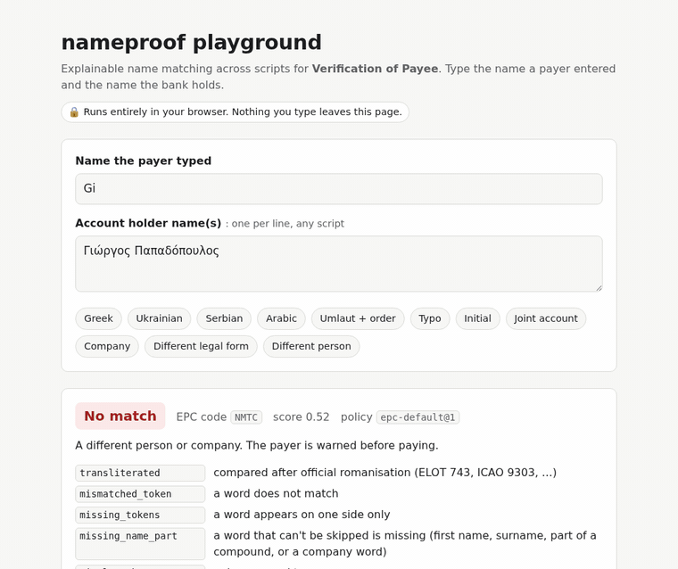
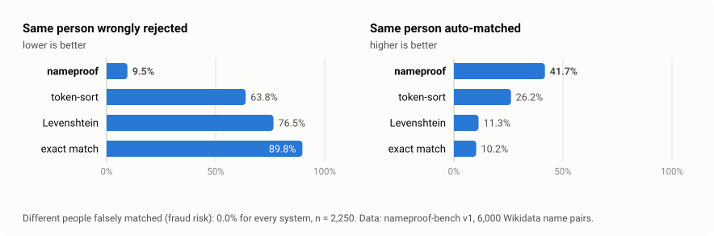

# nameproof

[](https://github.com/nadaboulaares/nameproof/actions/workflows/ci.yml)
[](https://pypi.org/project/nameproof/)
[](pyproject.toml)
[](LICENSE)

**Is this the same person? Explainable name matching across scripts.**

Is *"محمد علي"* the same person as *"Mohamed Ali"*? Is *"Fatma Trabelsi"* the
*"فاطمة الطرابلسي"* on another list? Is *"Γιώργος Παπαδόπουλος"* the *"Giorgos Papadopoulos"*
a customer typed? `nameproof` answers **Match / Close match / No match** and explains every
decision, so people only review the uncertain cases.

**[▶ Try it in your browser](https://nadaboulaares.github.io/nameproof/)**: nothing you type leaves the page.

<a href="https://nadaboulaares.github.io/nameproof/"></a>

```bash
pip install nameproof
```

- **Arabic, Greek and Cyrillic** against Latin spellings: official romanisations (ELOT 743,
  ICAO 9303, national systems); Arabic through consonant skeletons (*Mohamed*, *Muhammad*,
  *محمد*), always a close match for review because Arabic spelling is ambiguous
- **Real names**: diacritics (*José García*, *Wałęsa*, *Müller* = *Mueller*), initials, word
  order, particles (*ben*, *al-*, *van der*), compound names, titles, patronymics, joint names
- **Organisations**: about 1,400 legal forms (SARL, GmbH, Sp. z o.o., ΑΕ, ЕООД, …) from the
  GLEIF ISO 20275 list
- **Knows Arabic names**: about 170 common given names with their usual spellings, so
  *Hussein* = *Hocine* = *حسين* and *Youssef* = *Yusuf*, while *Mahmoud* vs *محمد* (both
  m-h-m-d without vowels) is no match; Maghreb spellings too (*Larbi* = *العربي*,
  *Belgacem* = *بلقاسم*, *Brahim* = *إبراهيم*)
- **Careful by design**: a spelling difference is never a full match for payments; *Ahmed*
  vs *حامد* (Hamid) is no match; every answer comes with reason codes
- **Find duplicates in a list** of thousands of names: [in your browser](https://nadaboulaares.github.io/nameproof/dedupe.html)
  (paste names or open a CSV; nothing is uploaded) or `nameproof dedupe people.csv`
- **Private and fast**: pure Python, runs offline or in the browser, about a millisecond per
  check, bounded work for crafted input

### Where it's used

| | |
|---|---|
| **Charities, zakat and aid organisations** | spot the same beneficiary registered twice, once in Arabic and once in Latin letters |
| **Clinics and health records** | link a patient's records across spellings |
| **Recruiting, schools and HR** | merge duplicate candidates or students |
| **Travel** | compare a booking name with the passport (ICAO 9303) |
| **Payments** | EU Verification of Payee: an [EPC responder](#verification-of-payee-service) is included; see [nameproof for banks](docs/FOR-BANKS.md) |

nameproof compares **names only**. Matching records properly also uses dates of birth,
phone numbers or ID numbers; nameproof is the name part of that decision.

**Background:** [Why fuzzy matching fails EU Verification of Payee](https://dev.to/nadaboulaares/why-fuzzy-matching-fails-eu-verification-of-payee-and-what-to-do-about-greek-cyrillic-and-arabic-29aa), the
design and the lessons from the pre-release review.

## Find duplicates in a list

**[▶ Find duplicates in your browser](https://nadaboulaares.github.io/nameproof/dedupe.html)**:
paste names or open a CSV file, then download the groups as a CSV. Your list never leaves
your computer. Or from the command line:

```console
$ nameproof dedupe examples/beneficiaries.csv
3 groups of likely duplicates in 9 names (2 to review); 7 pairs compared.

Group 1 (review)
  row     2  محمد بن علي
  row     3  Mohamed Ben Ali
  row     7  Mohamed Ben Ali
    rows 2 & 3: CLOSE_MATCH (transliterated, approximate_transliteration, fuzzy_token)
    rows 3 & 7: MATCH (identical)

Group 2 (review)
  row     5  Fatma Trabelsi
  row     6  فاطمة الطرابلسي
    rows 5 & 6: CLOSE_MATCH (transliterated, approximate_transliteration, fuzzy_token)

Group 3
  row     9  Γιώργος Παπαδόπουλος
  row    10  Giorgos Papadopoulos
    rows 9 & 10: MATCH (transliterated)
```

It reads a CSV (with a header row; pick the column with `--column`) or a text file with one
name per line, and `--output` writes the rows that have duplicates, with `group` and
`review` columns, ready to sort in a spreadsheet. From Python:

```python
from nameproof.dedupe import find_duplicates

report = find_duplicates(["Fatma Trabelsi", "Ahmed Salah", "فاطمة الطرابلسي"])
report.groups  # (DuplicateGroup(members=(0, 2), needs_review=True),)
```

Comparing every pair of a 10,000-name list would take 50 million checks, so names are
first grouped by a coarse, cross-script consonant key per word, and only names sharing a
key are compared, with exactly the rules of `match`. On the 9,624 distinct names of
nameproof-bench this compares 147,000 pairs instead of 46 million and keeps 98% of the
same-person pairs `match` finds (the rest are mostly heavy typos); it takes about 30
seconds on 8 cores. A group needs review whenever one of its links is a close match. Duplicate finding uses the
`records@1` policy by default: known spellings of one name (*Mohamed* / *Mohammed* /
*Muhammad*) count as the same name.

## Benchmark

<picture>
  <source media="(prefers-color-scheme: dark)" srcset="docs/assets/benchmark-dark.svg">
  
</picture>

On [nameproof-bench](bench/README.md), 6,000 labelled name pairs across Greek, Cyrillic,
Arabic and Latin scripts built from Wikidata, against typical fuzzy-matching baselines:

| | nameproof | token-sort | Levenshtein | exact |
|---|---|---|---|---|
| Same person **wrongly rejected** (lower is better) | **9.4%** | 63.8% | 76.5% | 89.8% |
| Same person **auto-matched** (higher is better) | **41.7%** | 26.2% | 11.3% | 10.2% |
| Different people **falsely matched** (fraud risk) | **0.0%** | 0.0% | 0.0% | 0.0% |

Everything nameproof doesn't auto-match or reject is a `CLOSE_MATCH`: the payer is shown
the real name and decides. Typos and initials land there by design. Full per-script and
per-variation results: [docs/BENCHMARK.md](docs/BENCHMARK.md).

```bash
uv run nameproof bench bench/data/nameproof-bench-v1.jsonl
```

## Verification of Payee service

`nameproof` also ships an HTTP responder that speaks the **EPC VoP Inter-PSP API**
(EPC103-24 v1.1.1) and is tested against the EPC reference test cases (EPC139-25 v1.2):

```bash
pip install "nameproof[service]"
NAMEPROOF_DIRECTORY=json:examples/accounts.json nameproof serve
```

```console
$ curl -X POST localhost:8080/vop/v1/payee-verifications -H 'Content-Type: application/json' \
    -H "X-Request-ID: $(uuidgen)" -H "X-Request-Timestamp: $(date -u +%FT%TZ)" \
    -d '{"party": {"name": "Yorgos Papadopoulos"}, "partyAccount": {"iban": "GR1601101250000000012300695"},
         "partyAgent": {"financialInstitutionId": {"bicfi": "ABCDBEBBXXX"}},
         "requestingAgent": {"financialInstitutionId": {"bicfi": "ABCDBEB0XXX"}}}'
{"partyNameMatch":"CMTC","matchedName":"Giorgos Papadopoulos"}
```

Docker image, configuration, account-directory plugins and the conformance table:
[docs/SERVICE.md](docs/SERVICE.md).

## Quickstart

```python
from nameproof import match

match("Jon Smyth", ["John Smith"])
# Verdict(result=CLOSE_MATCH, score=0.8442, suggested_name='John Smith', explanation=('fuzzy_token',), ...)

match("Mueller Anna", ["Anna Müller"]).result  # MATCH  (letter_expansion, token_reorder)
match("Maria Garcia", ["Mario Garcia"]).result  # CLOSE_MATCH, never MATCH: spellings differ
match("John Smith", ["John and Mary Smith"]).result  # MATCH  (joint_account_holder, shared_surname)
```

```console
$ nameproof match "Jon Smyth" "John Smith"
CLOSE_MATCH  score=0.8442  policy=epc-default@2
  suggested name: John Smith
  why: fuzzy_token
```

**How verdicts work** (default policy `epc-default@2`, following
[EPC288-23 v2.0](https://www.europeanpaymentscouncil.eu/sites/default/files/kb/file/2026-11/EPC288-23%20v2.0%20EPC%20Recommendations%20for%20the%20Matching%20Processes%20under%20the%20VOP%20Scheme%20Rulebook.pdf)):

| Result | When |
|---|---|
| `MATCH` | identical after clean-up: case, diacritics, punctuation, titles, word order of a person's name, official romanisation of the stored name. A person's extra middle names or a trailing female patronymic are allowed (first and last name exact) |
| `CLOSE_MATCH` | small differences: a typo, swapped letters, an initial, an abbreviation, a dropped particle (*van*), a legal form spelled differently or missing, company words in another order. The real name is returned so the payer can decide. A clearly different word in a person's name (*Mohamed* vs *Mahmoud*) is not a small difference |
| `NO_MATCH` | a different person or company, or too little to go on (a surname alone, initials alone, a generic word like *GmbH*) |
| `NOT_POSSIBLE` | nothing to compare: empty, longer than 140 characters or 10 words, or a script nameproof can't romanise yet |

Banks that accept dropped particles, legal-form variants and reordered company names as
a match can use the `lenient@2` policy, and lists of people (beneficiaries, patients) the
`records@1` policy, where known spellings of one name (*Youssef* / *Yusuf*) match. A
published policy never changes its thresholds or switches; the matching rules improve with
each nameproof version, so pin both for audit (every verdict records its policy).

Every verdict lists stable explanation codes (`Reason`) that never contain name fragments,
and the account holder's name is only ever exposed on `CLOSE_MATCH`.

## Data sources

- Company legal forms: the [ISO 20275 Entity Legal Forms code list](https://www.gleif.org/en/lei-data/code-lists/iso-20275-entity-legal-forms-code-list)
  v1.6, published by GLEIF under CC0 1.0. nameproof is not affiliated with or endorsed by GLEIF.
- Benchmark names: [Wikidata](https://www.wikidata.org/) (CC0 1.0), deceased people only.
- Romanisation tables are written from the public standards (ELOT 743, ICAO 9303, BGN/PCGN,
  the Bulgarian and Ukrainian national systems).

## Development

```bash
uv sync
uv run pytest
```

See [CONTRIBUTING.md](CONTRIBUTING.md). Report security issues privately — see [SECURITY.md](SECURITY.md).

Licensed under [Apache-2.0](LICENSE).
